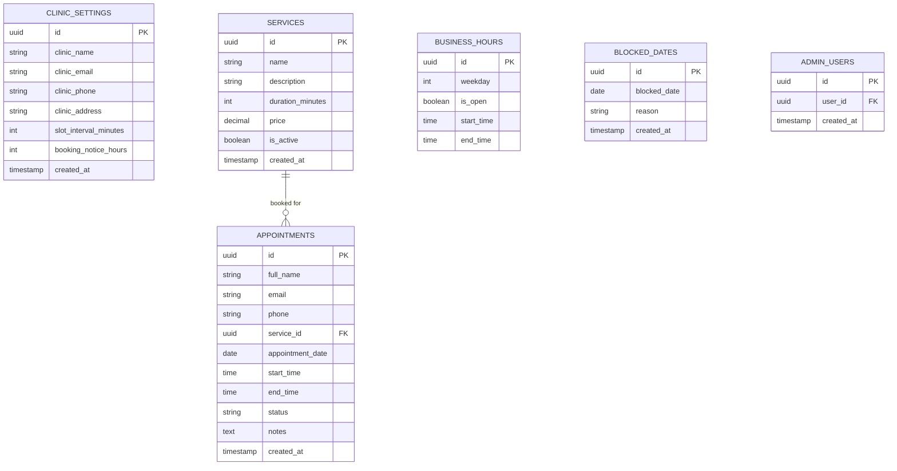

# 🦷 Blue Crest Clinic — Dental Booking & Practice Management Platform

[](https://react.dev/)
[](https://www.typescriptlang.org/)
[](https://vitejs.dev/)
[](https://tailwindcss.com/)
[](https://supabase.com/)
[](LICENSE)

A modern, full-stack appointment scheduling and dental practice management platform built for **Blue Crest Clinic**. The application provides an elegant, patient-friendly portal for exploring dental procedures and booking real-time appointments, backed by a comprehensive administrative dashboard for clinic operations, scheduling rules, and appointment reviews.

---

## 🏥 Clinic Identity & Contact Information

| Contact Channel | Details |
| :--- | :--- |
| **Brand Name** | **Blue Crest Clinic** |
| **Tagline** | Exceptional dental care for a healthy, confident smile |
| **Primary Phone** | [`+1 (555) 248-3273`](tel:+15552483273) |
| **Alternative / 24/7 Hotline** | [`+1 (555) 987-6543`](tel:+15559876543) |
| **Primary Email** | [`info@bluecrestclinic.com`](mailto:info@bluecrestclinic.com) |
| **Alternative / Booking Email** | [`appointments@bluecrestclinic.com`](mailto:appointments@bluecrestclinic.com) |
| **Physical Address** | 742 Blue Crest Boulevard, Suite 300, Medical Plaza, Metro City, NY 10001 |
| **Consultation Hours** | **Mon – Fri:** 8:00 AM – 6:00 PM<br>**Saturday:** 9:00 AM – 3:00 PM<br>**Sunday:** Emergency On-Call |

---

## 🌟 Key Features

### 1. Patient Portal
- **Service Catalog**: Browse dental treatments with pricing, durations, and clear descriptions.
- **Dynamic 14-Day Calendar**: Intuitive date picker evaluating clinic schedule in real time.
- **Intelligent Slot Engine**:
  - Automatically factors in service duration (e.g., 30, 45, 60 minutes).
  - Respects weekly clinic business hours and break intervals.
  - Excludes administrator-blocked holiday dates.
  - Enforces advance booking notice thresholds (e.g., minimum 24 hours notice).
  - Automatically eliminates overlapping or double-booked slots.
- **Booking Stepper**: Clean, guided 3-step experience (Service selection &rarr; Time slot &rarr; Patient info).
- **Instant Booking Confirmation**: Generates reference confirmation summary with immediate clinic contact guidance.

### 2. Clinic Operations & Admin Dashboard
- **Secure Authentication**: Protected administrative routes powered by Supabase Auth with admin role verification.
- **Appointments Management**:
  - Filter appointments by status: `pending`, `confirmed`, `completed`, or `cancelled`.
  - Approve or decline incoming appointment requests in real-time.
  - Patient detail viewer with direct contact links and clinical notes.
- **Services Catalog Management**:
  - Add, edit, or toggle dental services.
  - Customize procedure duration, pricing, and active status.
- **Business Hours Configuration**:
  - Configure operational days and opening/closing hours per weekday.
  - Toggle days open or closed (e.g., weekend schedules).
- **Blocked Dates Management**:
  - Blackout specific days for holidays, facility maintenance, or staff training.
- **General Practice Settings**:
  - Manage public clinic identity (Name, Phone, Email, Physical Address).
  - Adjust booking engine parameters (Slot interval minutes, minimum advance notice hours).

---

## 🛠️ Technology Stack

| Layer | Technology | Details |
| :--- | :--- | :--- |
| **Frontend Framework** | React 19 (`react`, `react-dom`) | Modern component architecture |
| **Language** | TypeScript 5.8 | End-to-end type safety |
| **Build Tooling** | Vite 6 | Rapid HMR and optimized production bundling |
| **Styling** | Tailwind CSS v4 (`@tailwindcss/vite`) | Utility-first responsive design system |
| **Animations** | Motion (`motion/react`) | Fluid page and component transitions |
| **Routing** | React Router DOM v7 | Client-side routing with nested layouts |
| **Icons** | Lucide React | Clean, scalable dental and interface icons |
| **Backend & Auth** | Supabase (`@supabase/supabase-js`) | Authentication and relational PostgreSQL database |
| **Date Utilities** | `date-fns` | Appointment calculation, slot parsing, and formatting |

---

## 📂 Project Structure

```bash
Blue-Crest-Clinic/
├── index.html                # HTML entry point with metadata & branding
├── package.json              # Project dependencies and script runner
├── tsconfig.json             # TypeScript compiler settings
├── vite.config.ts            # Vite & Tailwind CSS plugins
├── vercel.json               # SPA rewrite configuration for Vercel
├── .env.example              # Environment variables template
│
└── src/
    ├── App.tsx               # Route definitions (Public & Admin)
    ├── main.tsx              # React DOM entry point
    ├── index.css             # Tailwind CSS entry & base styling
    │
    ├── assets/
    │   └── images/           # Dental service and clinic visuals
    │
    ├── components/
    │   └── layout/
    │       ├── Navbar.tsx    # Header with clinic branding & direct phone
    │       ├── Footer.tsx    # Footer with primary & alternative contact details
    │       ├── PublicLayout.tsx # Layout wrapper for public pages
    │       └── AdminLayout.tsx  # Protected layout with sidebar navigation
    │
    ├── lib/
    │   ├── supabase.ts       # Supabase client instantiation
    │   └── utils.ts          # Class merging utility (clsx + tailwind-merge)
    │
    ├── pages/
    │   ├── public/
    │   │   ├── Home.tsx      # Landing page, hero, services, about, & contact section
    │   │   └── Booking.tsx   # Multi-step appointment reservation engine
    │   │
    │   └── admin/
    │       ├── Login.tsx              # Admin authentication screen
    │       ├── DashboardOverview.tsx  # Analytics and appointment highlights
    │       ├── AppointmentsPanel.tsx  # Appointment review & status updates
    │       ├── ServicesPanel.tsx      # Add/edit dental treatments
    │       ├── BusinessHoursPanel.tsx # Weekly working hours editor
    │       ├── BlockedDatesPanel.tsx  # Holiday and closure dates manager
    │       └── ClinicSettingsPanel.tsx# Contact info & slot engine settings
    │
    └── types/
        └── index.ts          # TypeScript interfaces (Service, Appointment, etc.)
```

---

## 🗄️ Database Architecture

The application communicates with a PostgreSQL database managed via Supabase with the following core entities:



---

## 🚀 Getting Started

### Prerequisites

- **Node.js**: v18.0.0 or higher
- **npm** or **pnpm** package manager
- A **Supabase** project (or local Supabase instance)

### Installation

1. **Clone the repository:**
   ```bash
   git clone https://github.com/harshineeshree/Dental-clinic-booking.git
   cd Dental-clinic-booking
   ```

2. **Install project dependencies:**
   ```bash
   npm install
   ```

3. **Configure Environment Variables:**
   Copy `.env.example` to `.env`:
   ```bash
   cp .env.example .env
   ```
   Provide your Supabase credentials:
   ```env
   VITE_SUPABASE_URL=https://your-project-id.supabase.co
   VITE_SUPABASE_ANON_KEY=your-supabase-anon-key
   ```

4. **Start the local development server:**
   ```bash
   npm run dev
   ```
   Open [http://localhost:3000](http://localhost:3000) in your browser to view the application.

5. **Typecheck & Build for Production:**
   ```bash
   npm run lint
   npm run build
   ```

---

## 🔒 Security & Admin Access

- **Protected Routes**: All `/admin/*` routes verify active session tokens and ensure the authenticated user exists in `admin_users`.
- **Row Level Security (RLS)**: Public users have insert-only access for appointment submissions and read-only access for active services and business hours.
- **Data Validation**: Strict input parsing and appointment conflict checks prevent concurrent duplicate bookings.

---

## 📄 License

This project is licensed under the Apache License 2.0. See the [LICENSE](LICENSE) file for complete details.
